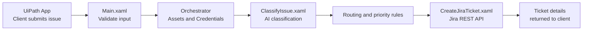

# IT Support Portal: AI-Powered Ticket Routing with UiPath

An automated client support intake system built with UiPath. External clients describe their IT issue in plain language on a web portal, and the automation classifies it with AI, routes it to the relevant internal team and raises a Jira ticket in seconds, with no manual handling.

---

## Problem Statement

### Background
Companies that provide IT services to external clients receive support requests through many channels, such as email, phone calls and chat. These requests arrive as unstructured text, and a support agent has to read each one before any work can begin.

### Problem
Manual triage of client requests is slow and inconsistent:

- Agents must read every request and decide its category, priority and the internal team responsible.
- Tickets are created by hand in the ticketing system, delaying the start of work.
- Similar issues are classified differently by different agents, leading to inconsistent priorities.
- Requests are often sent to the wrong team and have to be reassigned.
- Clients don't receive an immediate confirmation or ticket reference.
- There is no clear record of why a ticket was routed the way it was.

### Objective
Build an automated intake system where external clients submit issues through a web portal, and UiPath automatically classifies, prioritizes and routes each request to the relevant internal team by creating a Jira ticket.

---

## Key Features

- **Client self-service portal** built with UiPath Apps
- **AI classification** of category, subcategory, priority and confidence using an LLM
- **Confidence-based routing**: uncertain requests go to Triage for human review
- **Automatic Jira ticket creation** through the Jira REST API
- **Audit trail** on every ticket showing the client, the AI decision and the routing
- **Instant confirmation** with ticket number, team and status shown to the client
- **Secure configuration** using Orchestrator Assets and Credentials

---

## How It Works

1. **Submission:** the client enters their name and describes the issue on the portal.
2. **Validation:** requests shorter than 15 characters are rejected with a clear message.
3. **Configuration:** the Jira site, project key and credentials are read securely from Orchestrator.
4. **AI classification:** the request is sent to an LLM (Claude Haiku 4.5 via UiPath GenAI Activities) with a strict JSON schema, returning category, subcategory, priority and confidence.
5. **Business rules:** the category is mapped to the responsible internal team and Jira component. Anything below **0.6** confidence goes to **Triage**.
6. **Ticket creation:** a Jira issue is created with the correct component, priority and a full audit trail.
7. **Confirmation:** the ticket key, category, priority, assigned team and status are shown to the client instantly.

---

## Routing Rules

| AI Category | Jira Component | Internal Team |
|---|---|---|
| Hardware | Hardware | Hardware Support |
| Software | Applications | Application Support |
| Network | Network | Network Support |
| Access | Identity | IAM Team |
| Email | Messaging | Messaging Support |
| Unclassified, or confidence below 0.6 | Triage | Service Desk |

## Priority Mapping

| AI Priority | Jira Priority |
|---|---|
| Critical | Highest |
| High | High |
| Medium | Medium |
| Low | Low |

---

## Example

**Client request**
> My VPN is not connecting to the office network.

**Result**

| Field | Value |
|---|---|
| Ticket | ITSD-29 |
| Category | Network |
| Priority | High |
| Assigned To | Network Support |
| Status | To Do |

**Ticket created in Jira**

---

## Tech Stack

- **UiPath Studio**: workflow development (VB.NET expressions)
- **UiPath Apps**: client-facing portal
- **UiPath Orchestrator**: unattended execution, Assets and Credentials
- **UiPath GenAI Activities**: LLM-based classification via Integration Service
- **Jira Cloud REST API v3**: ticket creation
- **Newtonsoft.Json**: JSON request building and response parsing

| Package | Version |
|---|---|
| UiPath.System.Activities | 26.8.2 |
| UiPath.WebAPI.Activities | 2.5.2 |
| UiPath.IntegrationService.Activities | 1.33.0 |

---

## Project Structure

| File | Purpose |
|---|---|
| `Main.xaml` | Entry point: validation, configuration, routing rules and orchestration |
| `ClassifyIssue.xaml` | Sends the request to the LLM and parses the JSON classification |
| `CreateJiraTicket.xaml` | Builds the Jira payload and creates the issue through the REST API |
| `entry-points.json` | Input and output arguments exposed to the UiPath App |
| `project.json` | Project configuration and dependencies |

---

## Setup

### 1. Jira
- Create a Jira project (this project uses the key `ITSD`).
- Add these components: `Hardware`, `Applications`, `Network`, `Identity`, `Messaging`, `Triage`.
- Make sure the priorities `Highest`, `High`, `Medium` and `Low` exist.
- Generate an API token from [Atlassian account settings](https://id.atlassian.com/manage-profile/security/api-tokens).

### 2. Orchestrator Assets

| Asset Name | Type | Value |
|---|---|---|
| `Jira_Site` | Text | `https://your-site.atlassian.net` |
| `Jira_ProjectKey` | Text | `ITSD` |
| `Jira_Credential` | Credential | Username: your Jira email, Password: your API token |

### 3. GenAI Connection
Create a **UiPath GenAI Activities** connection in Integration Service and select it in the *Content Generation* activity inside `ClassifyIssue.xaml`.

### 4. Assignee
In `Main.xaml`, set `strAssignee` to your Jira account ID, or leave it empty for unassigned tickets.

### 5. Run
- **From Studio:** run `Main.xaml` and provide the client name (`in_EmployeeName`) and issue description (`in_Description`).
- **From the portal:** publish the process to Orchestrator and bind it to a UiPath App with matching input and output fields.

---

## Author

**Anousha Zaheer**

Automation Engineer

[LinkedIn](https://www.linkedin.com/in/anousha-zaheer-developer/)
